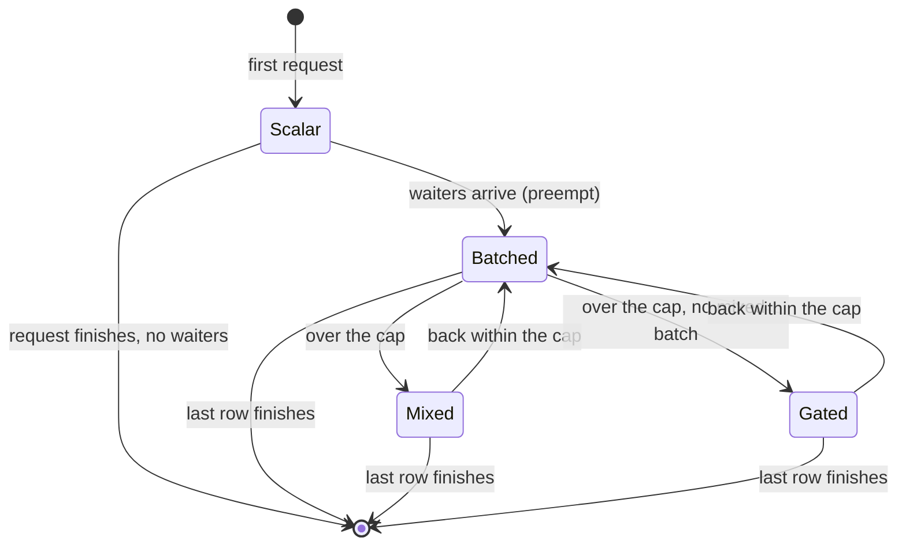

# Speculative batching

The server runs speculative decoding and continuous batching together, with
two decode loops, a width cap, and transitions that move a request between
the loops without interrupting its token stream. What speculation is and how
to enable it are in [Speculative decoding](../speculative-decoding.md). The
cap key is
[`speculative_width_cap`](../config.md#modelsspeculative_width_cap).

## The two decode loops

A speculative generation runs in one of two loops, chosen by live batch
width. The code is in `gmlx/spec/speculative.py`, and the transitions
between the loops are in `gmlx/spec/admission.py`.

The scalar loop serves one decoding request. Its draft and target samplers
share coupled RNG streams, so a sampled draft can be accepted against a
sampled target, which gives the highest acceptance rate. That makes it the
fastest path, and it is the common case.

Two or more decoding requests run in the batch loop. For each row it
tracks the KV offset, the budget, a finished flag and the bonus token, which
is the first token a verify round accepts beyond the drafted run and the
point the next round starts from. Drafting is greedy, since coupled RNG does
not extend across rows. Under kvarn KV, each row keeps its own start and
end, so a rollback trims each row by its own rejected count.

Each round checks the per-model width cap, the number of rows that can
speculate before verification widens each row's weight reads past the
point where drafting pays. A batch wider than the cap becomes a mixed
batch, described below, or decodes plain where a mixed batch does not
apply.

New requests join between verify rounds, when the loop drains an injection
queue. It checks the cap against the width the admission would reach,
extends the target KV cache with the new rows, and adds the rows to the
drafter while the drafter has a free row.

## Mixed batches

A mixed batch speculates on its oldest rows, as many as the cap allows,
and decodes the other rows plain in the same verify forward. Each plain
row fills its block with copies of its bonus token. The exact-match walk
accepts a copy only where the target emits the same token, so a plain
row's output is what plain decode gives, and the target cache rolls each
row back by its own accepted count. One forward reads the weights once
for every row, where a separate plain step would read them twice.

Every row of a mixed round verifies the same number of positions, so a
plain row's padding costs as much as a draft. A mixed round therefore
verifies a shorter block, about one full block of positions across the
batch and at least three per row, and the drafter's own block size
returns once every row speculates.

The speculating rows keep their drafter state and their acceptance rule.
At temperature above zero with a cap of 1, the speculating row takes the
scalar loop's stochastic walk, and the plain rows sample the target
distribution as plain batched decode does.

When a speculating row finishes, the oldest plain row takes its drafter
row, since a row left plain would lose the speedup for the rest of its
budget. A drafter that can hold a parked context for each plain row, as
DFlash and the native MTP head can, feeds it each round's committed
positions, so the promoted row drafts at once with its full context. A
parked context costs one drafter cache per plain row. Other drafters
start the promoted row cold from the round's verify capture, as a resumed
batch does.

A mixed batch needs a drafter that holds its own per-row state and a
target that rolls back each row separately. Drafters that read the
target's shared KV stay on the plain-decode gate. Targets with routed
experts stay on the gate too: a plain row's padded block widens the set
of experts each step reads, which costs the same as speculating on every
row. `GMLX_MTP_MIXED=1` forces mixed batches on such targets, and
`GMLX_MTP_MIXED=0` restores the gate for every model.

## Preempting a scalar generation

The scalar loop has no injection boundary, because its speed comes from
not being a batch. Making a waiter wait for the running request to finish
is worse on both measures. Its time to first token grows to the running
request's remaining generation, and aggregate throughput drops too,
because one speculating stream is slower than the same hardware decoding
several streams plain. When waiters queue behind a live scalar generation,
the server therefore preempts it:

1. The scalar generator closes, usually in the middle of a round. The
   round's verified tokens that were not yet delivered go out first, and
   their KV stays in the cache.
2. The generation is rebuilt as an unarmed batch-loop generator that
   restarts from the round's bonus token, with its real emitted count. Single-sequence caches convert to their batch classes.
3. The rebuilt loop's first injection drain admits the waiters. If
   the new width exceeds the cap, the batch decodes as a mixed batch or
   plain. Otherwise it arms itself with a capture round and keeps
   speculating.

At a cap of 1 with a mixed batch, the closing round commits its accepted
positions into the drafter before the rebuild. The rebuilt row keeps that
drafter and speculates from its first round, with no capture round.

## Re-arming a drained batch

A batch gated to plain decode, when a mixed batch does not apply, re-arms
when finishing rows bring it back within the cap. Re-arming needs fresh hidden state and shared KV for each
surviving row, so the resume path runs the generator's cold-start
sequence again instead of reusing per-row state:

1. A gated round dispatches the next round's forward before it reads its
   own tokens, and that forward has already appended its KV. The loop
   therefore runs one more plain round without dispatching a successor.
2. The capture round runs a one-position verify forward of each row's
   pending bonus token with hidden-state and shared-KV capture on, and
   emits one token per row at plain-decode cost.
3. The drafter resets and cold-starts from the capture.
4. Later rounds speculate normally at the drained width.

A batch whose rows are close to their budgets does not re-arm, since the
capture round would not pay for itself. A new admission in the same round
takes precedence over a pending resume, because the injection drain runs
first and trips the gate again, which keeps a batch from arming over the
cap.

## What the transitions guarantee

- Token streams are continuous across both transitions. Preempt restarts
  from the round's bonus token after the verified tail goes out, and
  resume consumes the plain lookahead before capturing. Nothing is
  skipped, emitted twice or sampled again.
- A preempted request decodes under batch-loop semantics for the rest of
  its generation, including after the batch drains to a single row. It
  drafts greedily, which lowers acceptance at temperature. The next
  request starts scalar again.
- A preempted request drops its prompt-cache retirement context, so its
  prefix is not offered back to the cache when it finishes.
- The capture round emits at plain-decode rate, and the speedup returns
  on the round after.

The transitions have off switches for A/B runs, `GMLX_MTP_PREEMPT`,
`GMLX_MTP_RESUME` and `GMLX_MTP_MIXED`, which the
[debug switches](debug-switches.md#speculative-decoding) list.
